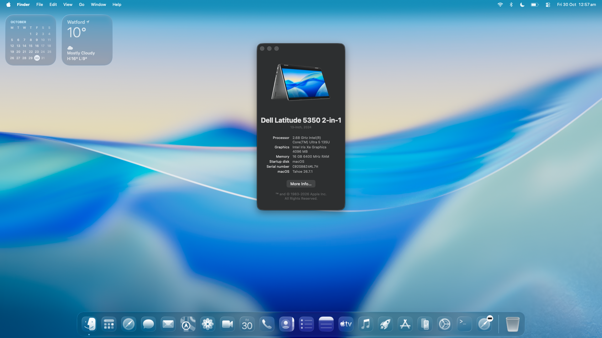

# Meteor Lake Xe-LPG Hardware Acceleration for macOS

-lightgrey.svg)


**Metal and Vulkan run on the Intel Core Ultra (Meteor Lake-P) Xe-LPG iGPU (`8086:7D45`) of a Dell
Latitude 5350 on macOS 15 Sequoia and macOS Tahoe 26.7.1**, with a working GPU-composited desktop.
The current Tahoe graphics checkpoint is **0.3.21**. **Updated 30 October 2026.**

This is a **retargeting**: the [NullMoth](https://github.com/nullmoth/nvidia-macos-driver)
NVIDIA-for-macOS driver tree is reused as the skeleton and every NVIDIA element is replaced with an Intel
one — GSP becomes GuC/HuC/GSC firmware, NVK becomes Mesa's **ANV**, and the NVIDIA kernel extensions
become an i915-derived `NMXGPU` on FreeBSD's **LinuxKPI** shim, plus a DRM user-client `NMXAccel`.

**Current state:** application rendering, the GPU-composited desktop, panel brightness, sound, Night Shift,
Bluetooth, Wi-Fi and the touchscreen work on the retained Dell profiles. Tahoe is now installed and booting;
performance, touchpad and the Apple-side subsystems remain under investigation. The separate **macOS 27
"Golden Gate"** runtime has reached native recovery services and **WindowServer startup**; its graphical
installer has not appeared yet.



*Latest screenshot: Tahoe 26.7.1, 16 GB RAM, custom Dell identity and the requested “Intel Iris Xe Graphics”
label. The physical GPU remains Meteor Lake Xe-LPG (`8086:7D45`); 4096 MB is reported shared graphics
memory, not dedicated VRAM. The screenshot does not replace rendering tests.*

**Start here**

| I want to… | Read / download |
|---|---|
| See what works | [Current results](#works) · [Open issues](#wip) |
| Get the current packages | [Tahoe graphics/audio, Wi-Fi, sources and macOS 27 engine](packages/) |
| Understand or build the port | [Architecture](#architecture) · [Build instructions](#build) |
| Check the evidence | [Validation](#validation) · [Dated research](research/) |

## 📑 Contents

<details>
<summary>Browse the full documentation</summary>

- [What works today](#works)
- [Status at a glance](#status)
- [The unified Dell candidate](#unified)
- [What is in progress](#wip)
- [Security warning](#security)
- [Hardware and software target](#target)
- [Compatibility](#compatibility)
- [Architecture](#architecture)
- [Component inventory](#components)
- [How it works](#how)
- [Validation and reproduction](#validation)
- [Diagnostics](#diagnostics)
- [Workspace layout](#workspace)
- [Building and testing](#build)
- [Roadmap](#roadmap)
- [Attribution and licensing](#licensing)
- [Design principles and decisions](#principles)
- [Glossary](#glossary)
- [FAQ](#faq)
- [Where this breaks with consensus](#consensus)

</details>

<a name="works"></a>
## ✅ What works today

| ✅ Working | ❌ Not yet |
|---|---|
| **GPU-composited WindowServer desktop**, real GPU work; historical readback **5.0 ms** (from 22.4 ms), not total frame time | Touchpad (ELAN04F3:328E) — **work in progress** |
| Metal render — 4,096 correct pixels | AWDL / AirDrop — radio data plane not connected |
| Vulkan compute — 65,536 correct values | Tablet mode — implemented, Dell validation pending |
| 26,000 exact frames across 22 cases (both transports) | Auto-rotation — no qualified live ISH publisher |
| Command-pool lifetime — 80,020 created / destroyed, zero leaks | On-screen keyboard — target runtime + Accessibility pending |
| **Brightness** (slider; keyboard helper/HUD integration still needs qualification) | Subpixel LCD text — system-app deployment open |
| **Sound** (Realtek ALC295; AppleALC on Sequoia, SimpleHDA on Tahoe) | Weather widget glyph artefacts — undiagnosed |
| **Night Shift** (gamma table) | Sleep/wake — not qualified |
| **Bluetooth** (AirPods Pro 2, MX Keys / MX Mechanical Mini; full Continuity unqualified) | |
| **Wi-Fi** (custom AirportItlwm) | |
| **Touchscreen** — multitouch and gestures | |
| **Apple services** — iMessage and the service stack | |
| **Copilot → Command** (VoodooPS2Keyboard macro inversion) | |
| **macOS Golden Gate boot UI** (GoldenGateExt theme + confirmed boot chime) | |
| **Accelerated graphics on every normal USB boot** | |
| GPU reporting — requested `Intel Iris Xe Graphics` display label, 4096 MB shared-heap cap; real PCI identity retained | |


**The application gate** is the measured baseline, not an inference: 22 cases (11 IOKit + 11 direct),
26,000 frames, 80,020 command pools created and destroyed with zero live, pending or quarantined —
report `readback-20261019-114424`, written up in `research/verified-0.3.1-full-gate-20261019.md`.
This **Sequoia** application gate has not been rerun as a fresh Tahoe 26.7.1 validation.

<a name="status"></a>
## 📊 Status at a glance

<details>
<summary>Evidence and validation for each milestone</summary>

| Milestone | Evidence | Status |
| :--- | :--- | :--- |
| Real GPU identification (`8086:7D45`, Dell `1028:0CB6`) | macOS probe and the laptop's own Linux report agree | **Confirmed** |
| `NMXGPU` i915 kext loads and attaches | Report `readback-20261019-114424`, kernel UUID match | **Confirmed** |
| MMIO / GGTT / firmware bring-up (GuC 70.53.0) | Kernel capture `kernel-guc-capture-1.0.9.log` | **Confirmed** |
| **Metal and Vulkan application rendering/compute** | 65,536 Vulkan values, 4,096 Metal pixels, 26,000 exact frames | **Working** |
| **GPU-composited WindowServer desktop** | Real GPU work, readbacks complete, no hang (`windowserver-result-224146`) | **Working — optimization continues** |
| GPU reporting in System Information | `Intel Iris Xe Graphics` UI label, 4096 MB shared-heap policy; hardware remains `8086:7D45` | **Working** |
| Wireless, Bluetooth, audio, Night Shift, brightness, touchscreen | On the Dell; see *The unified Dell candidate* | **Working** |
| Touchpad (ELAN) | Attaches and is readable; the device is not usable yet | **WIP** |
| AWDL / AirDrop | Native backend 0.1.4 compiles/links/signs; radio data plane incomplete | **Not functional** |
| Tablet mode, auto-rotation, on-screen keyboard | Implemented with local fixtures; live ISH publisher missing | **Validation pending** |
| System-wide subpixel LCD text | Renderer + CoreText frontend + native interposer tested locally | **Deployment open** |
| Sleep/wake, external displays, hardware video decode | No passing evidence | **Unverified** |

The original measurements are recorded under `research/`; later Tahoe runtime results also include
the working-checkpoint reports and user-confirmed hardware behavior. Keep those scopes separate.

</details>

<a name="unified"></a>
## 🧩 The unified Dell candidate

The combined Dell work covers graphics, wireless, audio, input, tablet features, text rendering and
the boot UI. Working features and unfinished experiments are tracked separately; packaged code alone
does not establish a hardware result. The authoritative combined status is `UNIFIED-CANDIDATE-WORK.md`; the
invariants that must survive every rebuild are in `AGENTS.md`.

<details>
<summary>Subsystem implementations, versions and validation details</summary>

| Subsystem | What was built | State |
|---|---|---|
| **GPU** — Metal, Vulkan, WindowServer | i915 on LinuxKPI, ANV, a custom Metal plugin, a custom framebuffer | **Working; Tahoe baseline 0.3.21** |
| **Wireless** — custom AirportItlwm | Linux `iwlwifi` ported to macOS: MTL PCI match `0x7E408086`, `iwlwifi-ma-b0-gf-a0-83.ucode`, fragmented PNVM loading, an internal auxiliary-station path (`itlwm_mtl_internal_aux=1`), custom receive Block Ack handling | **Working** |
| **Bluetooth** | IntelBluetoothFirmware + BrcmPatchRAM; the fork's LE Data Length Change fix clears the BLE bind stall | **Working** |
| **Audio** | Realtek ALC295 on `8086:7e28`; Sequoia: AppleALC 1.9.8 + Lilu 1.7.3 (compatibility device-id `ca510000`, layout-id 33); Tahoe: SimpleHDA, retaining `keepsyms=1` | **Working** |
| **Touchscreen** | VoodooI2CHID → VoodooInput → AppleMultitouchTrackpadHIDEventDriver, behind a guarded HID null-guard | **Working, gestures confirmed** |
| **Touchpad** | `LatitudeI2CMeteorLake` — a Legion-adapted VoodooI2C controller: D0 verified through PMCSR, bxt I2C timing from Linux `intel-lpss-pci.c`, an SSDT replacing the firmware's failing `_DSM`/`_CRS` (`XDSM`/`XCRS`) | **WIP** |
| **Boot UI — macOS Golden Gate** | GoldenGateExt theme `d43617a`, `PickerMode=External`, `PickerVariant=Acidanthera\GoldenGateExt`, `PickerAttributes=147`, auxiliary entries hidden (Spacebar reveals `ResetNvramEntry`), matching OpenCanopy/AudioDxe and a boot chime | **Theme and chime confirmed** |
| **Accelerated boot mode** | OpenCore NVRAM Delete+Add refresh of `nullmoth-gpu-once` / `nullmoth-panel-once`, so every normal USB boot is accelerated; `switch-graphics-mode.sh accelerated\|recovery` for manual override | **Working** |
| **Copilot → Command** | VoodooPS2Keyboard Info.plist macro inversion, retained and validated in every active, candidate and recovery EFI | **Confirmed** |
| **AWDL / AirDrop** | Native Intel backend 0.1.4 (74 units, ad-hoc signed) on the pinned `itlwm` base and the 24H32 `IO80211Family` 1200.13.1 ABI | **Not functional** — the radio data plane, peer discovery and transfer are not connected |
| **Tablet mode** | Live firmware reader 0.2.0, conditional device-local PS/2 gates, 500 ms debounce, stale-signal fail-open, flat hold | **Dell validation pending** |
| **Auto-rotation** | An x86_64 ISH PCI/IRQ/PIO/HID driver that passes firmware-emulation tests | **No live ISH publisher yet** |
| **On-screen keyboard** | 0.2.0 session app, foreground text-field check, live-state contract | **Target + Accessibility pending** |
| **Subpixel LCD text** | Filtered FreeType 2.14.3 renderer (RGB/RGB_V/BGR/BGR_V), a bounded coverage atlas, linear-light per-channel blending, a CoreText-shaped frontend, and a native `CTLineDraw`/AppKit/CA interposer | **System-app deployment open** |
| **Brightness, hotkeys, GPIO, power** | Brightness-keys route (`BRT6` to `PC00.LPCB.PS2K`), a latitude hotkey driver, a Linux-style GPIO map, a sleep/power snapshot | **Target validation pending** |

</details>

### macOS 27 "Golden Gate" — the standalone boot program

The supplied **macOS 27 build 26A428** is the ARM64 target for this separate firmware-runtime experiment.
The working Intel Sequoia/Tahoe graphics port remains a separate track.

The ambition is **Snapintosh for the Dell**: boot macOS 27 on the Intel Meteor Lake machine *directly from
firmware*, with no Linux host and no Sequoia loader — which on this hardware means an **ARM-to-x86
translation layer beneath the kernel**, the piece Snapintosh gets for free on a Snapdragon.

The original **0.0.3 preflight** source lives in [`macos27-standalone/`](macos27-standalone/).
The full-engine experiments have advanced beyond it. The current source, upstream overlay and diagnostic
EFI are now published in [`macos27-standalone/full-engine/`](macos27-standalone/full-engine/) and the
[dated package release](packages/); the original preflight folder remains historical.

<details>
<summary>Earlier 0.0.3 preflight milestone and its verification</summary>

* **Original preflight milestone (preserved).** `EFI/Tools/Dell27Preflight.efi` — an x86_64 UEFI application that runs with no Linux
  and no Sequoia. It admits exactly four hash-pinned macOS 27.0 build 26A428 / Mac14,3 inputs (`bootkc`,
  `dtree`, `sptm`, `txm`), inventories firmware RAM and GOP dimensions, validates ARM64 MH_FILESET
  load-command bounds, and then executes a bounded A64 program through a portable interpreter compiled into
  the binary: scalar move-wide, ADD/SUB, logical shifted-register operations, NZCV, ADR/ADRP, direct,
  conditional and register branches, calls/returns, integer loads/stores, NOP and BRK, with permission and
  overflow-checked private buffers. Version 0.0.3 adds a checked ARM64 MH_EXECUTE loader (813 boundary
  checks), selected non-trapping EL2 state (OSLAR, DAIF masks, CurrentEL, VBAR, reset HCR read) and an
  independent 19-instruction privileged probe.
* **Original preflight verification (preserved).** ASan/UBSan with 85 execution and fault checks; a 69-instruction ARM payload
  produces the same 80 bytes as independently executed pinned QEMU TCG; the exact x86 EFI binary runs inside
  OVMF and is compared byte-for-byte against that oracle; a separate OVMF run rejects a one-byte altered
  device tree. After admission the probe rereads and rehashes SPTM, maps it into private memory, executes
  its first branch and four setup instructions, then **intentionally stops at the first boot-argument
  read**. Unsupported instructions, bad maps, faults and instruction budgets terminate execution — an
  unsupported system instruction is never treated as a successful no-op.

</details>

* **Current full-engine progress — 30 October.** Native Darwin 27 kernel execution and pmap startup,
  HFS recovery-root bring-up, **launchd, recoveryosd, OpenDirectory, LaunchServices and CoreServices**
  startup have been observed. **Native WindowServer startup is now reached**; earlier baseline captures
  also show its CoreAnimation/HID threads, session setup and IOSurface connection initialization.
  The runtime exposes **16 GiB logical guest RAM** with bounded sparse backing. MMU/COW, exceptions,
  PAC, timer/interrupt, PCI, VirtIO storage, AES, RTC, GPIO and framebuffer paths have implemented,
  tested support. Firmware tests include **4,096 QARMA comparisons, 72 monitor/PAC checks and 768 SPRR
  checks**. These are component results, not a completed installer boot.
* **Current performance candidate.** The compiled x86 UEFI engine now combines bounded word-wise
  copy/fill, a faster read-only observer filter and unchanged-frame suppression in the GOP presenter.
  Memory and presenter fixtures pass, as do the real x86 firmware/CPU checks and modified-capture
  rejection. A valid-image boot is running with persistent ownership, run-state and exit-code records;
  it has reached native WindowServer startup again. There is no completed full-boot speed measurement.
* **What remains.** **The graphical installer is not visible yet:** the latest actual display captures
  are black. Native process startup is a substantial milestone, but it does not establish an interactive
  installer. Display/renderer initialization, installer keyboard/pointer input, physical target storage
  and installation on the Dell still need qualification. The no-Metal compatibility path follows native
  timeout cleanup; it is not itself a software compositor or GPU acceleration.
* **Hardware and USB status.** The current full runtime has not been qualified on the physical Dell.
  The working Tahoe EFI remains preserved. A separate diagnostic loader and checked inputs were staged
  alongside it on USB; this is not an installer release and does not replace the Tahoe boot path.

The native-integration work on the 24H32 build (the AWDL/`IO80211Family` ABI, the CoreText/FreeType text
path, the ISH tablet sensors) re-anchors on the Golden Gate frameworks when the runtime gets there: each
framework's ABI is versioned against the running OS, so that is a re-derivation per framework, not a version
bump. `research/iwlwifi-api83/` holds the Linux `iwlwifi` API-83 source and `research/airportitlwm-tahoe/`
a qualified upstream reference (Tahoe 26.6.2 / 26.7 with AppleVTD, AWDL/P2P, AirPlay and Screen
Mirroring) — the blueprint for that move.

<a name="wip"></a>
## 🧭 What is in progress

| Item | What is missing |
|---|---|
| **Touchpad** (ELAN04F3:328E) | Trials caused lag/erratic movement and keyboard freezes; gestures and the final Dell controller configuration remain unresolved |
| **AWDL / AirDrop** | The radio data plane, peer discovery and file transfer are not connected. **AirDrop does not work** |
| **Tablet mode** | Dell validation. The Intel HID switches are confirmed by the Linux capture; the Dell WMI switch stays false |
| **Auto-rotation** | macOS has no qualified live ISH sensor publisher yet |
| **On-screen keyboard** | Target runtime and the Accessibility permission |
| **Subpixel LCD text** | System-app interception and GPU-backed CA layers |
| **Brightness, hotkeys, GPIO, power** | Target validation on the Dell |
| **Weather glyph artefacts** | Reproducible, but not localized — the last capture ran without Weather |
| **Graphics smoothness** | Frame-time/publication stalls, remaining fence timeouts and glyph regressions; the retained Tahoe checkpoint is 0.3.21 |
| **macOS 27 standalone runtime** | Native Darwin 27, recovery services and WindowServer startup reached. Current display captures are black; graphical installer, input and physical installation remain unverified |

### Next

- **The macOS 27 standalone runtime** — continue from native recovery services and WindowServer startup
  toward the graphical installer. See *macOS 27 "Golden Gate" — the standalone boot program*.
- **Complete the Apple-side subsystems on 24H32** — AWDL radio qualification, a live ISH publisher,
  system-wide subpixel text deployment.
- **Qualify the remaining peripherals on the Dell** — touchpad, brightness keys, hotkeys, sleep/wake.
- **Sustained use** — longer soak, sleep/wake cycles and external displays are still unverified.

<a name="security"></a>
## ⚠️ Security warning

| Setting | Effect |
|---|---|
| `csr-active-config = 0x0A43` | Disables large parts of System Integrity Protection |
| `SecureBootModel = Disabled` | Disables Apple Secure Boot |
| AMFIPass + `amfi_get_out_of_my_way=0x1` | Bypasses AMFI code-signing enforcement |
| Custom kexts in the Auxiliary Kernel Collection | Unsigned, unnotarised kernel code runs at boot |

**Do not do this on a machine holding irreplaceable data or credentials.** A boot loop, a kext panic or a
damaged kernel collection can make the installation unbootable. Keep a known-good EFI on a separate USB
drive and a full backup off-device. This is an experimental hardware-porting project, not a supported
configuration.

<a name="target"></a>
## 🎯 Hardware and software target

| | |
|---|---|
| Machine | Dell Latitude 5350 (2-in-1) |
| CPU | Intel Core Ultra 5 135U — 12C/14T (2 P Redwood Cove + 8 E Crestmont + 2 LP E), CPUID `A06A4` |
| iGPU | Meteor Lake-P Xe-LPG, PCI `8086:7D45`, subsystem `1028:0CB6`, rev 08 |
| Wireless | Intel `8086:7E40` (Meteor Lake) on a **custom AirportItlwm** |
| Touch input | I2C-HID multitouch screen and ELAN04F3:328E touchpad on `8086:7E7B` |
| Audio | Realtek ALC295 on `8086:7e28` at `00:1f.3` |
| OS | Sequoia 15.8.1 (24H32) and installed Tahoe 26.7.1 (25G241), x86_64 |
| Graphics stepping | `B0` |
| Cache/coherency | `has_llc=no`, `has_snoop=yes`, `has_flat_ccs=no` (from the laptop's Linux report) |
| Firmware | GuC **70.53.0**, DMC **2.23**, HuC **8.5.4**, GSC **102.1.15.1926** |

The GPU model is not guessed: the macOS PCI probe and the Linux `i915` report from the same physical
laptop identify the same device, the same stepping and the same firmware family. That agreement is what
makes the retargeting plan viable, and it is the reference point every kernel experiment is measured
against.

**Custom wireless.** AirportItlwm 2.4.0 (laobamac Sequoia build `d695c97`, `com.zxystd.AirportItlwm`) —
the macOS port of Intel's Linux `iwlwifi` — with Meteor Lake changes on top: the `0x7E408086` PCI match,
`iwlwifi-ma-b0-gf-a0-83.ucode` with a custom fragmented PNVM loader, an internal auxiliary-station path
(`itlwm_mtl_internal_aux=1`), custom receive Block Ack handling
(`airport-sequoia-rx-aggregation-test16`), and firmware/scan/link/station/key status properties. The EFI
**enables AirportItlwm and disables the older `itlwm` 2.3.0**, so macOS uses its native Wi-Fi integration
path (`en0`) rather than the separate itlwm/HéliPort setup.

**Touch input.** The ELAN touchpad and the multitouch screen sit on the I2C3 controller `8086:7E7B`
(`_SB.PC00.I2C3.TPD0`). `LatitudeI2CMeteorLake` subclasses VoodooI2C's PCI controller: it restricts
vendor/device/subsystem, discovers the PCI PM capability instead of assuming its offset, requests and
verifies D0 (the firmware leaves the controller in D3hot, where every read returns `0xffffffff`), and
refuses a nonresponsive controller before the base probe. The bxt I2C timing (133 MHz, SDA hold 42 ns,
SDA fall 171 ns, SCL fall 208 ns) comes from Linux `drivers/mfd/intel-lpss-pci.c`. Interrupts run through
**VoodooGPIO** with `linuxirq.h`, the Linux IRQ-mapping shim that routes a Linux-style GPIO interrupt onto
macOS; where no community GPIO data exists (MTL `INTC1082`/`INTC1084`) the driver **polls**
(`-vi2c-force-polling`) rather than guessing a pin. The firmware's failing `TPD0._DSM` (`HIDG` missing) is
replaced by an SSDT — the HID DSM returns firmware `TPDH`, and `_CRS` concatenates the device's own
`SBFB`/`SBFI` buffers — changing only the method names (`XDSM`/`XCRS`) and the checksum.

> **Note on neighbouring hardware.** The sibling `NullMoth-Xe` work targets **Panther Lake / Xe3
> (`8086:b080`)** as an SR-IOV virtual function on a QEMU host. Meteor Lake is **Xe-LPG**, a different
> generation with different memory and firmware behaviour (`has_flat_ccs=no` here, flat-CCS remedies
> there). Xe2/Xe3 flat-CCS and VF power/firmware workarounds must **not** be copied onto this device.

<a name="compatibility"></a>
## 🖥️ Compatibility

The same Dell now has Sequoia and Tahoe hardware evidence; the application gate remains scoped to Sequoia.

| Target | Status |
|---|---|
| Dell Latitude 5350, `8086:7D45`, macOS 15.8.1 (24H32), x86_64 | **Tested** — see *What works today* |
| Other Meteor Lake SKUs exposing `8086:7D45` | **Untested** — same device ID, no claim made |
| Meteor Lake SKUs with a different device ID | **Untested** — `IOPCIPrimaryMatch` must change |
| Alder Lake / Raptor Lake iGPUs | **Not targeted** |
| Lunar Lake (Xe2) / Panther Lake (Xe3) | **Not supported** by this port |
| Dell Latitude 5350, macOS Tahoe 26.7.1 (25G241), x86_64 | **Installed and working desktop** — graphics checkpoint 0.3.21; see the new screenshot. Original full gate not repeated |
| Tahoe 26.6.2 (25G83) | Recovery-family ABI reference; not a universal installed-system qualification |
| macOS 15.0–15.7 / other Tahoe builds | **Untested** unless separately qualified |
| macOS 27 ARM64 runtime on Intel | **Native WindowServer startup reached in firmware tests; graphical installer and Dell installation unverified** |
| Apple Silicon | **Not applicable** |

Changing the device ID alone is not a port. Each new target needs its own firmware match, memory/cache
assumptions and a fresh 22-case gate. "Unknown" is not "works".

<a name="architecture"></a>
## 🧭 Architecture

```
Metal app
   │
   ▼
NVMTLDriver.bundle          ← out-of-tree Metal driver plugin (NSBundle-loaded user client)
   │  • NVMTLDevice / NVMTLAccelerator  (IOKit-facing provider subclasses)
   │  • NVMTLObjects.m                   (resource, texture, sampler, surface lifetime)
   │
   ▼
libnvmtl_translate.dylib    ← Apple AIR → SPIR-V shader translator
   │  (based on metal2vulkan; LGPL-3.0 / GPL-3.0)
   │
   ▼
ANV (Mesa Vulkan)           ← Intel Vulkan backend, built from Mesa 26.3.0-devel
   │  patched for the i915-on-xnu path
   │
   ▼
libdrm + xf86drm.c          ← userspace DRM abstraction, rebuilt as a pure IOKit render-node model
   │
   ▼
NMXAccel.kext               ← DRM user-client transport / accelerator (com.nullmoth.NMXAccel)
   │
   ▼
NMXGPU.kext                ← 438 i915 + DRM/TTM + LinuxKPI + compatibility + IOKit sources
   │  (com.nullmoth.NMXGPU, personality NMXGPUIntel)
   │
   ▼
Xe-LPG hardware  (GuC-managed engine, GGTT, DMC/HuC/GSC firmware)
```

Two transports are exercised and both matter: **direct** (the DRM device-file interface) and **IOKit**
(the render-node transport). The gate runs 11 cases on each route. A call named `drmNmxIoctl` does not
prove IOKit was used, so each case logs and verifies the route it actually took.

<a name="components"></a>
## 🧱 Component inventory

<details>
<summary>Full component inventory, locations and licenses</summary>

| Component | Version / base | Source in tree | Licence |
|---|---|---|---|
| `NMXGPU.kext` | kernel **1.0.15** (GPU-startup stolen-region reservation) | `latitude-desktop`, `drm-kmod`, `freebsd-src` | i915/Linux → GPL-2.0; NullMoth wrapper PolyForm NC |
| `NMXAccel.kext` | **0.2.9** (gamma tile, bulk transfer, copy-time counter) | `accel-build/NMXAccel.kext` | NullMoth PolyForm NC |
| `LatitudeMTLFB.kext` | **0.2.12** (GPU identity, shared-memory reporting, gamma table, captured EDID) | `desktop-build/LatitudeMTLFB.kext` | project |
| Guarded HID | **1.0.1** (VoodooI2CHID null-guard) | `desktop-build/hid-nullguard/` | project |
| Metal plugin | `NVMTLDriver`: **0.3.21** working Tahoe checkpoint; **0.3.19** published Sequoia builder (phase measurements, pipeline cache, 4 GiB backend cap) | `NullMoth/plugin/` | PolyForm NC |
| Shader translator | AIR → SPIR-V (metal2vulkan) | `NullMoth/translator/` | LGPL-3.0 / GPL-3.0 |
| Vulkan backend | ANV on Mesa **26.3.0-devel** | `mesa/` | MIT |
| DRM userspace | libdrm 2.4.x | `libdrm/` | MIT |
| DRM kernel modules | linuxkpi port of Linux DRM | `drm-kmod/` | MIT / GPL-2.0 |
| LinuxKPI | FreeBSD compatibility layer on xnu | `freebsd-src/`, `latitude-desktop` | BSD-2-Clause |
| Firmware | GuC/DMC/HuC/GSC | `firmware/i915/` | see `firmware/LICENSE.i915` |
| Wi-Fi | **AirportItlwm 2.4.0** (custom laobamac Sequoia build) | preserved EFI | iwlwifi → GPL-2.0 |
| Audio | **AppleALC 1.9.8** + Lilu 1.7.3 (ALC295, layout-id 33) | upstream bundles | GPL-2.0 |
| Bluetooth | **IntelBluetoothFirmware** + BrcmPatchRAM | `research/bluetooth-i2c-a16/` | GPL-2.0 |
| Touch input | VoodooI2C 2.9.1 + VoodooI2CHID + VoodooGPIO + Legion adaptation | `research/voodooi2c-core/`, `touchpad-sources/` | GPL-2.0 |
| AWDL / AirDrop | Native Intel AWDL backend **0.1.4** | `wireless-sources/`, `port-artifacts/awdl-*` | iwlwifi → GPL-2.0 |
| Tablet / ISH | Tablet-state reader **0.2.0**, ISH runtime, rotation, on-screen keyboard | `tablet-sources/` | project |
| Subpixel text | Filtered FreeType 2.14.3 + CoreText frontend + native interposer | `subpixel-sources/` | FTL / GPL-2.0 |
| Hotkeys / GPIO / power | Latitude hotkeys, GPIO map, power/sleep snapshot | `hotkey-sources/`, `gpio-sources/`, `power-sources/` | project |
| Boot UI | GoldenGateExt `d43617a` + OpenCanopy/AudioDxe | `boot-ui-sources/` | third-party theme |
| Input & boot policy | Copilot→Command macros, persistent accelerated-boot mode | `copilot-sources/`, `graphics-mode-sources/` | project |
| Kernel build headers | MacKernelSDK | `MacKernelSDK/` | Apple |
| Security bypass | AMFIPass 1.4.1 | `AMFIPass/` | not in this tree — verify upstream |
| Topology/inject kexts | Lilu, VirtualSMC, … | OpenCore `Kexts/` | mixed |

Exact revisions for every patched base are in `latitude-runtime/BUILD-MANIFEST.json`; upstream package
hashes are in `SHA256SUMS-upstream.txt`.

</details>

<a name="how"></a>
## 🔬 How it works

**1. Kernel bring-up.** `NMXGPU` is the Linux `i915` driver compiled against a LinuxKPI compatibility
layer on xnu, restricted to `8086:7D45`: **438** i915, DRM/TTM, LinuxKPI, compatibility and IOKit sources,
with AMD and Xe drivers deliberately excluded and **no unresolved driver-internal C symbols**. Activation
is a one-shot NVRAM opt-in, so a failed attach cannot silently re-arm on every boot.

**2. Firmware and the GuC.** Initialisation writes the GPU's MMIO register blocks during early kernel
boot and loads firmware whose versions match the laptop's own Linux report exactly. A **reproduced
software race** was fixed here: the FreeBSD LinuxKPI woken callback did not persist `TASK_WAKING`, so a
reply arriving between the outer flag check and sleep registration could signal an empty channel and the
waiter would sleep to expiry. The override sets `TASK_WAKING` under the same sleep-channel lock; the old
and patched callbacks plus the real i915 `must_wait_woken` are extracted into a deterministic fixture that
reproduces the false expiry across **100,000 scenarios**.

**3. Memory.** Metal resources reach the GPU through three distinct address spaces — **DSM** (device
physical), **GSM/PTE** (graphics-memory-relative) and **GGTT** (translation-table virtual) — and
conflating them is a known trap. Command pools are created fresh and destroyed immediately after fence
completion, and uncertain completions are **quarantined** rather than reused. Kernel 1.0.15 reserves the
firmware's console image from i915's stolen allocator, which is what stopped GPU initialisation from
allocating over the live framebuffer.

**4. The translation stack.** The translator lowers Metal's **AIR** to **SPIR-V** for ANV, which compiles
and submits it (1,045 build steps; CLC tools built separately for the Apple Silicon host).
`xf86drm.c` is reworked into a unified IOKit render-node model and the plugin subclasses
`NVMTLDevice`/`NVMTLAccelerator` so the GPU appears as a legitimate node in the I/O Registry.

**5. Security and injection.** `csr-active-config = Data 430A0000` (`0x0A43`), `SecureBootModel =
Disabled`, **AMFIPass 1.4.1** after Lilu, and the `amfi_get_out_of_my_way=0x1` / `amfi=0x80` /
`ipc_control_port_options=0` arguments the NullMoth setup requires. GPU-hiding `DeviceProperties` are
removed and the `csr-active-config`/`boot-args` entries sit in `NVRAM → Delete` so prior values are
replaced on the next boot. No persistent `nmxintel` boot argument — activation is one-shot.

<a name="validation"></a>
## ✅ Validation and reproduction

The 22-case hardware gate runs **before** any desktop boot is armed. It proves deterministic upload →
render → readback → exact-pixel comparison on real hardware, 1,000 iterations per case, both transports
with route markers checked rather than assumed, and pool accounting of
`created = destroyed = completed + abandoned` with zero live/pending/quarantined. The suite **refuses to
arm** a desktop boot unless the loaded kernel/plugin/libdrm hashes match the package, the boot UUID is
current, and the parser sees no timestamped kernel GPU-hang, TLB-timeout/reset or fault events.

It does **not** prove sustained stability, arbitrary workloads, or anything about the desktop's
smoothness. Local test passes (ASan/UBSan, mocked Vulkan calls, installer rollback fixtures) validate
**code paths only** and are never presented as hardware results.

```bash
# 1. confirm the recorded configuration
cd latitude-runtime
shasum -a 256 -c SHA256SUMS.txt
cat BUILD-MANIFEST.json
sw_vers; sysctl -n machdep.cpu.brand_string

# 2. the two smallest results (GPU work, no desktop)
./tools/latitude-vulkan-test ./tools/check.spv     # PASS … real 8086:7d45, 65536 verified values
./tools/latitude-metal-test                        # PASS render: 4096 pixels checked after shader execution

# 3. the 22-case gate (26,000 frames)
sudo /bin/bash latitude-desktop/test-readback.sh 1000 full
# → latitude-desktop/reports/readback-<timestamp>/
grep -c ' exit=0$' results.txt    # expect 22
cat hang-check.txt                # expect empty
```

<a name="diagnostics"></a>
## 🔎 Diagnostics

<details>
<summary>Diagnostic commands and failure signatures</summary>

Run these **before** rebooting or reinstalling: a failed boot's unified log is often gone after the next
restart. The rule is **collect first, reboot second, reinstall last** — installing a new candidate over a
failed boot destroys the evidence that the candidate failed.

```bash
# Is the GPU visible to IOKit?
ioreg -l -p IOService | grep -i -E "7d45|NMXGPU"

# Did the kexts actually load (not just install)?
kextstat | grep -i -E "nmxgpu|nmxaccel"

# GPU and display state
system_profiler SPDisplaysDataType

# Our driver's messages, last 10 minutes
log show --last 10m --predicate 'eventMessage CONTAINS "NMXGPU"'
log show --last 10m --predicate 'eventMessage CONTAINS "CoreUltraGraphics"'

# Kernel GPU events
log show --last 10m --predicate 'eventMessage CONTAINS "GPU HANG" OR eventMessage CONTAINS "TLB"'

# Command-ring words (the 0xff000000 overwrite) and the parsed request/GuC state
log show --last 10m --predicate 'eventMessage CONTAINS "NMX-i915-ring"'
log show --last 10m --predicate 'eventMessage CONTAINS "NMX-i915-request" OR eventMessage CONTAINS "NMX-i915-first-error"'

# An allocation refused because its host pages are not contiguous
log show --last 10m --predicate 'eventMessage CONTAINS "refusing noncontiguous"'

# Kernel panics (including the 1.0.13 boot panic at 8 s uptime)
ls -t /Library/Logs/DiagnosticReports/Kernel-*.panic | head -1
log show --last 10m --predicate 'eventMessage CONTAINS "used before mtx_init"'

# Newest WindowServer crash report
ls -t ~/Library/Logs/DiagnosticReports/WindowServer*.ips | head -1

# Full failure bundle, before any reinstall
sudo /bin/bash /Volumes/SEQOUIA/iGPU-Port/collect-desktop-failure.sh
```

Signatures worth recognising: `GPU HANG 12:1:00dfffff` (the GPU stopped progressing — capture request
and GuC state, do not raise the fence timeout); `VK_TIMEOUT` after 5000 ms (find the first *uncompleted*
submission, not the first timeout); `VkResult -1000072003` (IOSurface import refused — the private-image
fallback should still complete); `GPUWranglerWaitForPublish` (no GPU was ever published — check
`kextstat`, then the AuxKC bundle paths); `NullMoth xkpi: mutex 0x… (?) used before mtx_init` (a `struct
mtx` whose `mtx_lk` is `NULL` — an object that never passed through `mtx_init()`; not contention and not
a timeout).

</details>

<a name="workspace"></a>
## 📂 Workspace layout

<details>
<summary>Source tree and research-file guide</summary>

```
iGPU Port/
├── AGENTS.md               # Invariants that must survive every rebuild
├── UNIFIED-CANDIDATE-WORK.md # Authoritative combined status across all subsystems
├── AMFIPass/  MacKernelSDK/  MyIntelGPU/  Vulkan-Headers/  accel-build/
├── NullMoth/               # Upstream NVIDIA-for-macOS tree: kexts/, plugin/, translator/, nvk/
├── NullMoth-Xe/            # Sibling Panther Lake / Xe3 SR-IOV VF work (separate target)
├── backups/  build-inputs/  build-tree/  checkpoints/  desktop-build/  desktop-sources/
├── drm-kmod/  freebsd-src/  libdrm/  mesa/  ogkm610/  toolchain/  upstream-runtime/
├── firmware/i915/          # mtl_guc_70.bin, mtl_dmc.bin, mtl_huc_gsc.bin, mtl_gsc_1.bin
├── latitude-desktop/       # Latitude-specific desktop glue
├── latitude-runtime/       # Installable runtime (Library/, BUILD-MANIFEST.json, SHA256SUMS)
├── port-artifacts/         # Per-candidate audit bundles (patches, logs, validation)
├── research/               # Dated evidence, Apple framework references, candidate notes
├── boot-ui-sources/  brightness-sources/  copilot-sources/  gpio-sources/
├── graphics-mode-sources/  hotkey-sources/  power-sources/  subpixel-sources/
├── tablet-sources/  touchpad-sources/  wireless-sources/  linux-live-media/
├── macos27-standalone/    # macOS 27 "Golden Gate" standalone-UEFI ARM-to-x86 program (0.0.3)
├── PORT-STATUS.md  ROADMAP.md  SHA256SUMS-upstream.txt
```

`research/` is the evidence trail — read the newest files first. The most load-bearing ones:

| File | Contents |
|---|---|
| `ROADMAP.md` (repo root) | **The dated history, 8–30 October 2026** — seventeen phases from the first injection failure to macOS 27 "Golden Gate" |
| `UNIFIED-CANDIDATE-WORK.md` (repo root) | **Authoritative combined status** across every subsystem |
| `iwlwifi-api83/` | Linux `iwlwifi` API-83 source — the reference for the native AWDL and radio work |
| `airportitlwm-tahoe/` | Qualified upstream reference (Tahoe 26.6.2/26.7, AppleVTD, AWDL/P2P, AirPlay) |
| `verified-0.3.1-full-gate-20261019.md` | The 22-case / 26,000-frame / 80,020-pool hardware gate record |
| `windowserver-result-224146.md` | **The usable-desktop checkpoint** — real GPU work, readbacks complete, no hang |
| `windowserver-result-231630.md` | GPU reporting fixed; the last smoothness capture |
| `smoothness-0.3.12.md` | Plugin 0.3.11's optimized cache path: readback **5.0 ms** (from 22.4 ms) |
| `nightshift-and-audio-0.3.16.md` | The gamma/Night Shift path and ALC295 audio |
| `panel-and-icon-0.3.14.md` | Captured BOE panel EDID (13.3") and the About This Mac icon |
| `tablet-macos-review-20261021-1504.md` | Tablet-mode macOS review and the firmware visibility gate |

</details>

<a name="build"></a>
## 🛠️ Building and testing

**Scope:** the commands below preserve the original **Sequoia source/build workflow**. Versioned 0.3.19
scripts do not reproduce the later Tahoe 0.3.21 checkpoint. Tahoe uses a separate qualified graphics/audio
package with exact framework-family/ABI checks and kernel-collection preflight/rollback. Do not bypass
a failed validation or install the Sequoia package onto Tahoe. Keep `keepsyms=1` for Tahoe SimpleHDA; it
retains symbols without enabling visible verbose boot. Current Tahoe payloads and matching sources are now available through [packages/](packages/).

The build is a pipeline: firmware is prebuilt, then the translator, the Vulkan backend, the Metal plugin,
the kernel extension and the kexts are compiled, the runtime is packaged, the application gate is run, and
only then is a desktop boot armed. Every step is a script in `desktop-sources/`.

**Prerequisites:** macOS 15 Sequoia x86_64, Xcode command line tools (`xcrun` must resolve),
`MacKernelSDK/`, Rust 1.87+ (`toolchain/`), `llvm-dis` and `spirv-val` (SPIRV-Tools), `meson` + `ninja`,
`python3`. The build host may be Apple Silicon or Intel; the CLC tools are built for the host.

```sh
# 1. Firmware — already in firmware/i915/, nothing to compile

# 2. AIR → SPIR-V translator
cd NullMoth/translator/translator && cargo build --release

# 3. ANV and libdrm
meson setup mesa     build-tree/mesa-build  && ninja -C build-tree/mesa-build
meson setup libdrm   build-tree/drm-build   && ninja -C build-tree/drm-build

# 4. Metal plugin
python3 desktop-sources/build-windowserver-0.3.19.py

# 5. Kernel extension — the hard part
#    (a) compile: NullMoth/gpu-port/xkpi/all.sh  -> obj/, obj-i915/, lkobj/, srcobj/, xnuobj/
#        all-i915.sh builds the i915 driver, cc-i915.sh is the per-file compiler
#    (b) link:
python3 desktop-sources/link-kernel-1.0.15.py

# 6. Kexts
python3 desktop-sources/build.py

# 7. Assemble the runtime package (the USB must be mounted)
python3 desktop-sources/publish-scanout-copy-0.3.19.py

# 8. Application gate
shasum -a 256 -c latitude-runtime/SHA256SUMS.txt
./latitude-runtime/tools/latitude-vulkan-test ./latitude-runtime/tools/check.spv
./latitude-runtime/tools/latitude-metal-test
sudo /bin/bash latitude-desktop/test-readback.sh 1000 full

# 9. Install on the Dell (one desktop boot)
sudo /bin/bash /Volumes/SEQOUIA/iGPU-Port/install-windowserver.sh
#    then reboot through the USB once (no ResetNVRAM), and collect before reinstalling:
sudo /bin/bash /Volumes/SEQOUIA/iGPU-Port/collect-desktop-failure.sh

# 10. Roll back
sudo /bin/bash latitude-runtime/rollback-runtime.sh
```

> **The kernel compile step is not reproducible as-is.** `NullMoth/gpu-port/xkpi/all.sh` and `cc-i915.sh`
> still contain absolute paths from the original build machine (`/Volumes/MiniData/build/gpu-src/...` and
> `/Users/ved/igpu-build/...`). They must be repointed at this tree (`NullMoth/gpu-port/xkpi`,
> `drm-kmod`, `freebsd-src`) before they will run.

The **historical macOS 27 0.0.3 preflight** builds separately, on the Corsair-backed build volume
(the current full-engine candidate is published in `macos27-standalone/full-engine/` and is not reproduced by these older commands):

```sh
cd macos27-standalone/Standalone-UEFI-Source
python3 test-runtime.py     # scalar/EL2 execution and fault checks
python3 build.py            # reruns the scalar tests, then compiles the x86_64 EFI binary
python3 test-uefi.py        # runs it inside virtual OVMF and compares against the QEMU oracle
```

**Never bypass a failed kernel-collection validation. Bring the report back instead.**

<a name="roadmap"></a>
## 🗺️ Roadmap

[`ROADMAP.md`](ROADMAP.md) is the authoritative, fully dated record — **8 to 30 October 2026, oldest
first** — and it is the document to read for the history. It has five parts:

1. **Where we are now** — the working state, the open items and the macOS 27 direction.
2. **How to read this document** — the four evidence rules: what worked needs its measurement, negative
   results stay negative, counts are exact and scoped, and plugin submission IDs and i915 request
   sequence numbers are never equated without correlation.
3. **Timeline** — seventeen phases, each with what happened, what it proved, the lesson and the evidence
   pointer: injection (`_kmod_info`), `EXITBS:START`, the pivot to NullMoth, first submissions and the
   first hang, the lost-wake race, the gate that finally meant something, the WindowServer
   variable-by-variable work, the ring capture and the falsified defect, the raw-physical span, the
   stolen-memory skip, the panic named, the desktop working, reporting/smoothness/the peripherals, the
   unified candidate, the AWDL radio and native backend, and the move to macOS 27 "Golden Gate".
4. **[macOS 27 dedicated roadmap](ROADMAP.md#macos27)** — native kernel/recovery services and
   WindowServer server-loop progress, the current candidate, blockers and graphical-installer gates.
5. **Method** — the evidence table, what the research changed, the implementation sequence with its
   promotion criteria, and the immediate deliverables with their boundaries.

Current position:

- **Now:** Sequoia's recorded 26,000-frame application baseline and a working **Tahoe 26.7.1 desktop**,
  restored to graphics **0.3.21**, with Wi-Fi, Bluetooth, ALC295 audio, Night Shift, panel brightness,
  touchscreen, Dell branding and confirmed boot chime. Windows/Fedora booting has also been confirmed.
  Separately, the **macOS 27 runtime has reached native Darwin 27, recovery services and WindowServer
  startup**; actual display captures remain black and the graphical installer is not verified.
- **Next:** resolve the macOS 27 display/renderer barrier, verify installer output and then qualify input
  and target storage. Continue Tahoe smoothness, touchpad, brightness-key integration, AWDL radio data,
  tablet-mode publication and system-wide subpixel text without replacing the passing checkpoints.
- **Later:** sustained soak, sleep/wake, external displays, hardware video decode.

**Promotion criteria (unchanged):** a desktop pass requires evidence that the candidate activated, the
desktop stayed responsive, **real frames were presented**, and no GPU/fence errors occurred; a visible
software-fallback desktop is **not** a pass. The 22-case gate must be revalidated when a candidate
changes the render path. No automatic reboot from any installer or test script.

<a name="licensing"></a>
## ⚖️ Attribution and licensing

This project is a **retargeting**, not original work. It stands on:

- [NullMoth / nvidia-macos-driver](https://github.com/nullmoth/nvidia-macos-driver) — driver skeleton,
  plugin, translator and the `xkpi` LinuxKPI-on-xnu layer. **PolyForm Noncommercial 1.0.0**; the kexts,
  plugin and translator carry this licence, which is **noncommercial** and materially different from
  the Apache-2.0 badge this README previously displayed.
- The [NullMoth-Xe](https://github.com/nullmoth/nvidia-macos-driver) Panther Lake write-up — the upstream
  portability fixes reused for drm-kmod, libdrm, Mesa and the plugin.
- Intel `i915`, DRM and TTM from the Linux kernel — **GPL-2.0**; firmware under `firmware/LICENSE.i915`.
- FreeBSD `linuxkpi` and `freebsd-src` — **BSD-2-Clause**.
- [Mesa](https://gitlab.freedesktop.org/mesa/mesa) 26.3.0-devel incl. ANV — **MIT**; `libdrm` — **MIT**.
- Khronos `Vulkan-Headers` — Apache-2.0 / MIT.
- The AIR→SPIR-V translator (based on `metal2vulkan`) — **LGPL-3.0** with **GPL-3.0** components.
- `ogkm610` — NVIDIA open kernel modules, MIT except where noted.
- **AirportItlwm** (the custom laobamac Sequoia build, `d695c97`, `com.zxystd.AirportItlwm` 2.4.0) — the
  macOS port of Intel's Linux `iwlwifi` driver, which is **GPL-2.0**. The Meteor Lake PCI match, the
  fragmented-PNVM loading and the `itlwm_mtl_internal_aux` path are this project's additions on that base.
- The **VoodooI2C** touch stack (VoodooI2C, VoodooI2CHID, VoodooGPIO) and the LegionI2CArrowLake
  adaptation — **GPL-2.0**, with the Legion kext under ISC.
- **AppleALC** 1.9.8 and **IntelBluetoothFirmware** / BrcmPatchRAM — by their respective authors, under
  their own terms.
- AMFIPass 1.4.1, Lilu and VirtualSMC — by their respective authors, under their own terms.

**Original work** (VedCloud code, scripts, patches, tests and documentation) is licensed under the
**[Meteor Lake Xe-LPG Metal Graphics License](LICENSE)**, whose grant is substantively equivalent to
Apache-2.0 and which is additionally available under Apache-2.0. **Third-party components are not
licensed by it** and remain under their own terms, enumerated in Schedule A of `LICENSE`.

Because the tree combines **GPL-2.0-only** code (e.g. `drm-kmod/drivers/gpu/drm/drm_gpuvm.c`,
`dma-buf/sync_file.c`) with **GPL-3.0** code (the translator) and with **PolyForm Noncommercial** code
(NullMoth), no single license covers the combined work: GPL-2.0-only and GPL-3.0 are mutually
incompatible, and PolyForm NC is incompatible with both the GPL and permissive relicensing. Those
incompatibilities are inherent to the upstreams and are not resolved by the project license. The
per-component licences are preserved in-tree (`latitude-desktop/licenses/`, `latitude-runtime/licenses/`,
and each upstream tree's own `LICENSE`/`COPYING`), and must remain in place.

<a name="principles"></a>
## 🧾 Design principles and decisions

1. **No guessed register values, quirk values or ACPI scope names.** If it is not measured or sourced, it
   is not written.
2. **No unsourced attributions.** Every external claim carries an exact URL, or the text says the source
   could not be found.
3. **Local build success ≠ hardware success.** Mocked tests are labelled as mocked; a passing compile is
   never reported as a passing device.
4. **One variable at a time**, with a saved before-state and a rollback path, and no automatic reboots.
5. **Negative results are recorded** and stay negative. `INTEL_DEBUG=stall`, longer timeouts and
   fabricated success are documented dead ends, not proposed fixes.
6. **Generation boundaries are respected.** Meteor Lake is not Panther Lake; Xe-LPG is not Xe3.
7. **The failure comes before its consequences.** GPU execution failure is reported as the failure;
   CoreDisplay crashes are reported as its aftermath.

Key decisions and the alternatives that were rejected:

| Decision | Alternative rejected | Why |
|---|---|---|
| Retarget NullMoth's driver skeleton | Write a Metal driver from scratch | The Metal plugin, translator and LinuxKPI-on-xnu base already existed |
| Base the kernel driver on `i915` | The `xe` driver | The laptop's own Linux reference and the available xnu DRM/LinuxKPI port are i915-based |
| Vulkan backend = ANV | NVK; software fallback | Xe-LPG is Intel silicon, and ANV is the mature Intel Vulkan backend in Mesa |
| Keep the AIR→SPIR-V translator | Rewrite the Metal frontend | Metal hands the plugin AIR, so lowering to SPIR-V is the shortest path to ANV |
| One-shot NVRAM opt-in for GPU activation | Always-on kext | A failed attach must not silently re-arm on every boot |
| Fresh command pools, destroyed immediately | Cache / pop / push pool reuse | Reuse was a variable in the hang; removing it was necessary, though not sufficient |
| Quarantine uncertain completions | Reuse resources after a timeout | Reusing work whose fence was never observed risks corrupting later submissions |
| Scope `noccs` and dedicated staging to this device | Change them globally | Isolates one variable without perturbing the passing application matrix |
| Kernel 1.0.9 changes diagnostics only | Change scheduling, reset policy or timeouts | No evidence supports a scheduling fix; capture the missing request/GuC state first |
| Never reboot automatically; collect before reinstall | Auto-retry the boot | The failed boot's unified log is the evidence; rebooting or reinstalling destroys it |
| Treat application and desktop as separate milestones | Assume one pass means "working" | 26,000 passing application frames do not predict desktop success |
| Pin i915 CPU user mappings for the mapping lifetime | Add a cache flush or raise the fence timeout | The port's revocation shim is a no-op, so a lifetime pin is the only way a static IOKit mapping is safe |
| Require `HostPhysicallyContiguous \| MapperNone` and verify the span | Trust `PhysicallyContiguous` and the base address alone | Apple's own code makes `PhysicallyContiguous` host-contiguous only when no system mapper exists |
| Reserve the firmware console image from stolen allocations | Leave the broad stolen-region skip or let i915 own the framebuffer | The skip broke GPU startup; allocating over the live framebuffer is what the reservation prevents |
| Ship each candidate as a candidate, not a fix | Call a hang solved because the mechanism was plausible | Every fix here was tested on hardware, and two real defects were falsified that way |

<a name="glossary"></a>
## 📖 Glossary

| Term | Meaning |
|---|---|
| **AIR** | Apple Intermediate Representation — Metal's shader IR, the translator's input |
| **ANV** | Mesa's Intel Vulkan driver |
| **AuxKC** | Auxiliary Kernel Collection — where third-party kexts are staged |
| **AWDL** | Apple Wireless Direct Link — the peer-to-peer protocol AirDrop and AirPlay use |
| **CLC** | Mesa's OpenCL C compiler |
| **DSM / GSM / GGTT** | Device physical / graphics-memory-relative / translation-table address spaces |
| **GEM / TTM** | DRM graphics-execution memory management and its translation-table manager |
| **GuC / HuC / DMC / GSC** | Intel GPU microcontroller and firmware: scheduling, media, display, security |
| **ISH** | Intel Sensor Hub — the low-power sensor/rotation interface |
| **LinuxKPI** | FreeBSD's Linux kernel API shim, used to compile i915 on xnu |
| **MATs** | Memory Attributes Tables — firmware memory-map support that selects booter quirks |
| **PNVM** | Wi-Fi calibration data the firmware loads at attach |
| **SIP** | System Integrity Protection |
| **SPIR-V** | Vulkan's shader IR |
| **Xe-LPG** | The GPU generation in Meteor Lake, distinct from Xe2 and Xe3 |
| **AirportItlwm / itlwm** | The macOS ports of Intel's Linux `iwlwifi` driver |

<a name="faq"></a>
## ❓ FAQ

<details>
<summary>Installation, runtime, Wi-Fi and licensing questions</summary>

**Does this actually work?**
For applications, yes: Metal and Vulkan produce exact, verified output (65,536 Vulkan values, 4,096
Metal pixels, 26,000 frames across 22 cases). The desktop **now works too** — WindowServer is
GPU-composited, does real GPU work and reads back correctly in the recorded runs. The remaining gaps
are the touchpad and the Apple-side subsystems in *What is in progress*.

**Can I install it on my laptop?**
The tested hardware is Dell Latitude 5350, `8086:7D45`, on Sequoia 15.8.1 and Tahoe 26.7.1, using
their separate matching packages. A different
device ID needs `IOPCIPrimaryMatch` changes and a fresh evidence run. There is no generic installer.

**Can I use it as a daily driver, for games or video editing?**
The desktop is usable, but a trouble-free daily-driver experience is not guaranteed: sustained stability,
sleep/wake and external displays are unverified, the touchpad is a work in progress and the Weather
glyphs are undiagnosed.

**Is it safe to install?**
No. It disables large parts of SIP and AMFI and loads unsigned kexts. A boot loop or a damaged kernel
collection can make the machine unbootable. Keep a known-good EFI on a separate USB and a full backup
off-device.

**Why did the desktop take so long if Metal works?**
Because composition is a different layer from application rendering. The gate passes with exact pixels,
but WindowServer exercises concurrent surface import, readback and panel scanout under load — paths the
application matrix never touches.

**Do brightness, sound and Night Shift work?**
Yes: panel brightness works through Control Centre and Night Shift through the framebuffer gamma table.
Brightness keys/helper-to-slider synchronization still need qualification. ALC295 audio uses AppleALC on
Sequoia and SimpleHDA on Tahoe; keep `keepsyms=1` for the latter. Bluetooth and Wi-Fi also work.

**Does Wi-Fi work?**
Yes. A custom AirportItlwm (the macOS port of Intel's Linux `iwlwifi`) drives the Meteor Lake wireless
controller, loads its firmware and registers `en0`. Wi-Fi works in the Tahoe installer and installed
system too. **AirDrop is not functional:** native AWDL peer-data and channel scheduling are unfinished;
browsing does not establish full Continuity.

**Is the GPU really doing the work, or is it a software fallback?**
The probes read exact values and pixels back from device memory and verify the transport route, so the
application results are real GPU execution. The desktop is GPU-composited: WindowServer submits real work
and the readbacks complete.

**Can I contribute? What do you need?**
The same hardware and reproducible evidence: the report directory, boot UUID, exact log lines and the gate
output. "It works for me" without logs is not usable, and neither is a local build pass presented as a
hardware result.

**Why is the license custom, and can I use this commercially?**
No — commercial use is not permitted for the combined tree, because the NullMoth components are PolyForm
Noncommercial 1.0.0. The custom license covers only VedCloud original work; the GPL, LGPL, MIT and BSD
components keep their own terms.

**Will this support Lunar Lake or Panther Lake?**
That is the separate `NullMoth-Xe` target. Xe2/Xe3 cache and firmware workarounds must not be applied to
Meteor Lake.

</details>

<a name="consensus"></a>
## 📈 Where this breaks with consensus

The common claim is that modular Intel Core Ultra parts are a dead end for modern macOS. On this machine
that claim is falsified well beyond the GPU:

- the GPU is **identified** and the i915-based kext **attaches** to it on real hardware;
- **GuC 70.53.0** firmware loads and submission is enabled;
- **Metal and Vulkan work** — 65,536 correct values, 4,096 correct pixels, and **26,000 application
  frames** passing exact-pixel validation over **both** transport routes;
- the **desktop is GPU-composited**, with real GPU work and clean recorded readbacks; Tahoe smoothness work continues;
- a **Linux Wi-Fi driver is ported and running natively on macOS** — a custom AirportItlwm drives the
  Meteor Lake wireless controller, loads its firmware and registers `en0`;
- a **Linux Bluetooth stack** and an **AppleALC** audio path work alongside it, and the screen is driven by
  a **Linux I2C-HID** driver;
- a real **LinuxKPI lost-wake race** was found, reproduced and fixed.

What remains open is narrower and mostly not about the GPU: the touchpad, the AWDL radio data plane,
tablet-mode publication, system-wide subpixel text, and the move to macOS 27 "Golden Gate".
